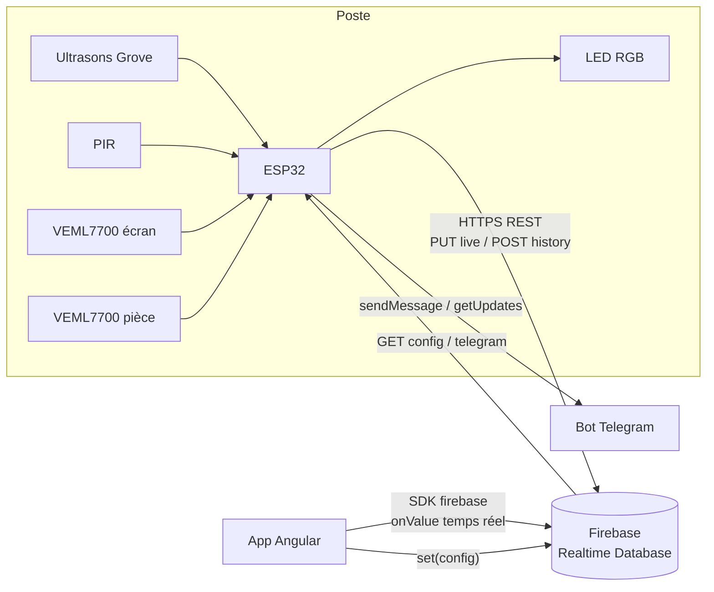

# DeskGuard — Assistant connecté de poste de travail

Projet du cours **Objets connectés** (EILCO Calais, MISC2 2026-2027).
Groupe : Hamza El Jmili, Imad El Khelyfy, Zakaria Falkou.

DeskGuard est un boîtier posé près de l'écran. Une carte ESP32 et quatre capteurs surveillent la distance entre l'utilisateur et l'écran, l'équilibre de la lumière et la durée passée assis. Une LED RGB indique l'état du poste. Les mesures partent vers Firebase et une application web (pensée pour le mobile) les affiche en direct, avec l'historique et les réglages. Les alertes peuvent aussi arriver sur Telegram.

Cahier des charges complet : [docs/Assistant_connecte_poste_de_travail_TD1.pdf](docs/Assistant_connecte_poste_de_travail_TD1.pdf).

| Fonction | Réalisation |
| --- | --- |
| FP1 Proximité prolongée | Alerte **rouge** si distance < 45 cm pendant 10 s (seuil et délai réglables) |
| FP2 Déséquilibre lumineux | Écart écran/pièce après calibration > 50 % pendant 10 s → **orange** |
| FP3 Rappel de pause | 50 min assis sans interruption de plus de 2 min → **orange** |
| FP4 Restitution mobile | App Angular temps réel (5 s), historique du jour et sessions |
| FC1 Wi-Fi | Envoi `live` toutes les 5 s (réglable de 1 à 10 s) |
| FC2 Stockage en ligne | Firebase Realtime Database : identifiant, horodatage, mesures, alertes, paramètres |
| FC5 Signal local | LED RGB vert / orange / rouge, fonctionne même sans réseau |
| FC6 Paramétrage | Page Réglages → `config` lue par l'ESP32 toutes les 30 s et mémorisée en NVS |
| Bonus | Alertes Telegram avec vérification du numéro, notifications navigateur |

## Architecture



### Données (`devices/<id>/…`)

| Nœud | Écrit par | Contenu |
| --- | --- | --- |
| `live` | ESP32, toutes les `sendPeriodS` s | Dernière mesure : `ts`, `distance`, `motion`, `present`, `seated`, `lux1`, `lux2`, `imbalance`, `sitMin`, `state`, `reason`, `alerts` |
| `history/<pushId>` | ESP32, 1/min et à chaque changement d'état ou de présence | Même format que `live` (indexé sur `ts`) |
| `config` | App (Réglages), ESP32 au 1er démarrage | `distMin`, `proxDelayS`, `imbalancePct`, `luxCal`, `lightDelayS`, `pauseMin`, `sendPeriodS`, `telegramOn` |
| `telegram` | App (demande) puis ESP32 (résultat) | `phoneHash` (SHA-256), `phoneLast2`, `code`, `status`, `chatId` |
| `telegramBot` | ESP32 au démarrage | Nom du bot, pour le lien `t.me/<bot>` |

`state` vaut `green`, `orange` ou `red`. `reason` vaut `ok`, `proximity`, `break` ou `light`. Le rouge l'emporte sur l'orange.

### Arborescence

```
firmware/esp32_firebase/   Sketch Arduino (esp32_firebase.ino, secrets.example.h)
application/my-app/        App Angular 20 (tableau de bord, historique, réglages)
firebase/                  Règles de la Realtime Database
docs/                      Sujet du TD
```

## Câblage

| Composant | Broche ESP32 | Remarque |
| --- | --- | --- |
| Ultrasons Grove (SIG) | GPIO 18 | Capteur monobroche (trig et echo sur le même fil) |
| PIR (SIG) | GPIO 19 | Entrée numérique |
| LED RGB — R / G / B | GPIO 17 / 16 / 4 | Cathode commune, via résistances ~220 Ω |
| VEML7700 n°1, côté écran | SDA 21, SCL 22 | Bus I2C 0 |
| VEML7700 n°2, côté pièce | SDA 32, SCL 33 | Bus I2C 1 (même adresse 0x10, d'où 2 bus) |
| Alimentation capteurs | 3V3 ou 5V / GND | Selon le module ; la carte est alimentée en USB 5 V |

## Lancer le firmware

1. Arduino IDE 2 avec le paquet de cartes **esp32 by Espressif** (testé en 3.3) et la carte « ESP32 Dev Module ».
2. Bibliothèques (Gestionnaire de bibliothèques) : **Adafruit VEML7700 Library** (installe aussi Adafruit BusIO) et **ArduinoJson** 7.
3. Copier `firmware/esp32_firebase/secrets.example.h` en `secrets.h`, puis remplir :
   ```c
   #define WIFI_SSID_VALUE       "MonReseau"
   #define WIFI_PASS_VALUE       "..."
   #define DB_URL_VALUE          "https://myapp-db367-default-rtdb.europe-west1.firebasedatabase.app"
   #define DEVICE_ID_VALUE       "esp32-01"
   #define TELEGRAM_TOKEN_VALUE  ""   // optionnel, voir plus bas
   ```
4. Téléverser, puis ouvrir le moniteur série à 115200 bauds. On y voit les mesures, l'état de la LED et les requêtes HTTP.

En ligne de commande : `arduino-cli compile --fqbn esp32:esp32:esp32 firmware/esp32_firebase`.

Sans Wi-Fi, les alertes locales (LED) continuent avec la dernière configuration enregistrée en NVS.

## Lancer l'application

```bash
cd application/my-app
npm install
npx ng serve
```

Ouvrir http://localhost:4200. Pour suivre un autre poste, ajouter `?device=esp32-02` à l'URL. Build de production : `npx ng build` (sortie dans `dist/my-app`).

Pages :
- **Tableau de bord** : état de la LED, distance, présence, lumière, temps assis, courbe du jour.
- **Historique** : sessions devant l'écran (de… à…), temps en bonne posture, en attention et en danger, verdict par session, frise de la journée, choix de la date.
- **Réglages** : seuils envoyés à l'ESP32, activation et liaison Telegram.

Les trois pages sont en FR/EN, avec mode clair/sombre, infobulles sur chaque indicateur, alerte à l'écran et notifications navigateur.

## Règles Firebase

Copier le contenu de [firebase/database.rules.json](firebase/database.rules.json) dans la console Firebase → Realtime Database → **Règles** → Publier. Ou bien, avec la CLI Firebase : `firebase deploy --only database`.

L'index `.indexOn: ts` est nécessaire à la requête « historique du jour ».

## Alertes Telegram (optionnel)

1. Dans Telegram, ouvrir **@BotFather**, envoyer `/newbot`, puis copier le token dans `TELEGRAM_TOKEN_VALUE`.
2. Téléverser le firmware. L'ESP32 publie le nom du bot dans `telegramBot`.
3. Dans l'app → Réglages → Alertes Telegram : saisir son numéro, puis **Vérifier le numéro**.
4. **Ouvrir le bot**, appuyer sur Démarrer, puis sur « 📱 Partager mon numéro ». L'ESP32 vérifie que le contact appartient bien à l'expéditeur et que le numéro correspond, puis enregistre le `chatId`.

Ensuite, un message part au début de chaque alerte, au maximum 1 toutes les 10 min par type. Un bot Telegram ne peut pas écrire à un numéro : l'utilisateur doit l'avoir démarré une fois, d'où cette étape.

## Tester sans ESP32

On peut simuler l'ESP32 depuis PowerShell avec l'API REST de Firebase :

```powershell
$db = "https://myapp-db367-default-rtdb.europe-west1.firebasedatabase.app/devices/esp32-01"

# Mesure en direct (horodatage serveur)
$live = @{
  ts = @{ ".sv" = "timestamp" }; device = "esp32-01"
  distance = 38.5; motion = $true; present = $true; seated = $true
  lux1 = 420; lux2 = 180; imbalance = 57; sitMin = 12
  state = "red"; reason = "proximity"
  alerts = @{ proximity = $true; light = $true; break = $false }
} | ConvertTo-Json -Depth 3
Invoke-RestMethod -Method Put -Uri "$db/live.json" -Body $live -ContentType "application/json"

# Une ligne d'historique
$row = @{
  ts = [DateTimeOffset]::UtcNow.ToUnixTimeMilliseconds(); device = "esp32-01"
  distance = 62; motion = $false; present = $true; seated = $true
  lux1 = 400; lux2 = 330; imbalance = 17; sitMin = 13; state = "green"; reason = "ok"
} | ConvertTo-Json
Invoke-RestMethod -Method Post -Uri "$db/history.json" -Body $row -ContentType "application/json"

# Lire la configuration, comme le fait l'ESP32
Invoke-RestMethod -Uri "$db/config.json"
```

L'app passe « Hors ligne » quand `live` n'a pas été mis à jour depuis plus de 15 s : c'est voulu. Pour garder l'état « En ligne », relancer le `PUT` régulièrement.

## Sécurité

Ce dépôt est un **prototype pédagogique** :
- **Règles ouvertes** : n'importe qui connaissant l'URL peut lire `devices/` et écrire `live`, `config` et `telegram`. Les règles valident seulement la forme des données. Pour un vrai déploiement, il faudrait Firebase Authentication (compte pour l'app, jeton pour l'ESP32) et des règles `auth != null` par appareil.
- **Numéro de téléphone** : comme la base est lisible publiquement, seule une empreinte SHA-256 des 9 derniers chiffres est stockée, jamais le numéro.
- **TLS** : l'ESP32 utilise `setInsecure()` (pas de vérification du certificat). Il faudrait embarquer le certificat racine.
- **Secrets** : `secrets.h` (Wi-Fi, token Telegram) est ignoré par git. Ne jamais le committer. Si un token a fuité, le régénérer avec `/revoke` dans @BotFather.

Les seuils proposés viennent du cahier des charges. Ce ne sont pas des normes médicales.
